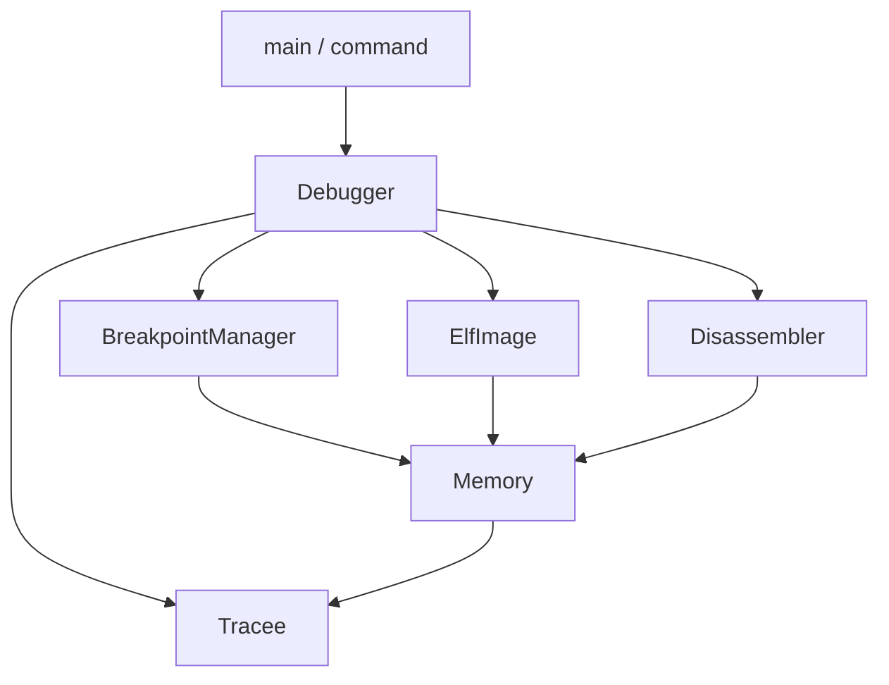
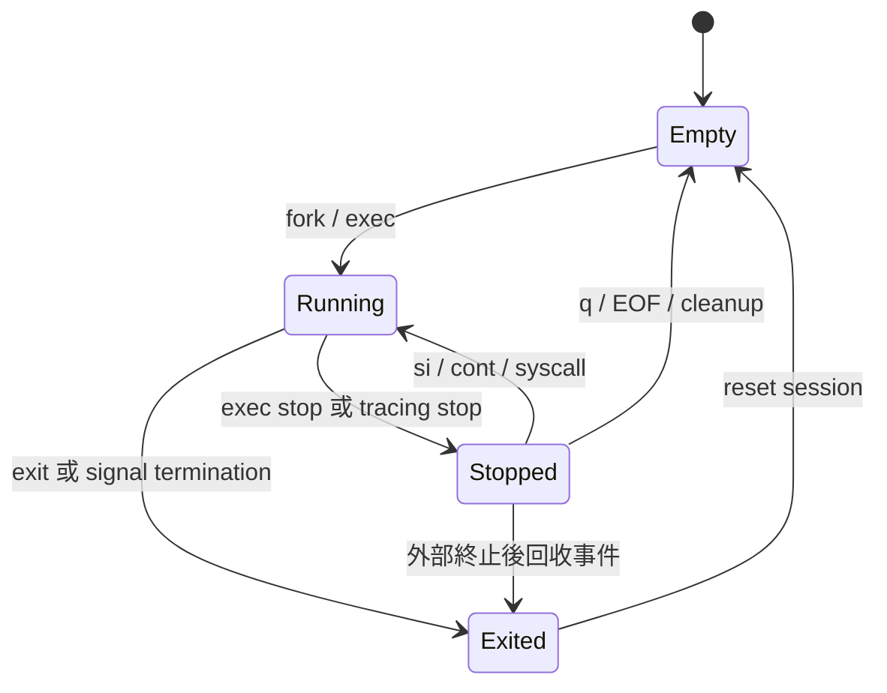

# SDB 逐步實作練習計畫

目標：從你熟悉的單檔 debugger，逐步練習到 `dev-reference` 的模組化版本。
每階段只處理一組責任，先理解現有程式，再修改、測試、提交。

目前工作樹已實作第一、二階段；下方第一階段紀錄保留為歷史，第二階段的
介面、建置與驗收方式見「第二階段：可重播的開發流程」。

## 分支與本次範圍

| 分支 | 用途 |
|---|---|
| `main` | 原始單檔版本：`sdb.cpp`、Makefile、gitignore |
| `dev` | 檔案與原始版本相同，保留先前歷史 |
| `dev-practice` | 你逐步練習的工作分支；本次完成第一階段 |
| `dev-reference` | 已完成的新版，供查閱設計與測試 |

原始碼仍可隨時查看：

```sh
git show main:sdb.cpp
git show dev-reference:src/tracee.cpp
git diff main -- src include Makefile
```

本次實作的是 **第一階段：架構整理與既有功能修 bug**。指令仍限於：

```text
load <path>
si
cont
syscall
break <hex-address>
breakrva <hex-offset>
info break
info reg
delete <decimal-id>
patch <hex-address> <hexbytes>
q
```

不把 reference 的新增能力提前搬入這個階段。符號斷點、attach/detach、記憶體指令、
暫存器寫入、硬體 watchpoint、backtrace、多執行緒、history、batch 都留給後續練習。
既有 `cont` / `si` / `syscall` 的 signal stop 分類與預設轉送屬於正確性修正，沒有新增 signal 參數。

## 練習順序

| 階段 | 要做的事 | 完成條件 |
|---|---|---|
| **1．架構與 bug（本次實作）** | 拆開 CLI、控制器、tracee、memory、breakpoint、disassembly、ELF entry；修生命週期與錯誤處理 | 原版六組成功行為保留；回歸與故障注入通過；說得清楚每個物件的責任 |
| 2．可重播的開發流程 | 加 `--batch` / command file、目標 argv、帶引號 parser；導入 CMake 與 Debug/Release/sanitizer CI | 同一份命令檔可本機與 CI 重播；錯誤與 skip 明確；每次改動能自動驗收 |
| 3．ELF symbols | 解析 `.symtab` / `.dynsym`，加入 `break main`，集中 runtime address 轉換 | PIE/non-PIE 都命中正確位置；stripped、同名與非函式 symbol 有明確處理 |
| 4．資料與暫存器操作 | 加 `x` / `write`、`register read/write`；必要時再抽出 RegisterFile | 邊界、權限、數值、不可讀位址可恢復；寫入與斷點 overlay 不衝突 |
| 5．互動訊號與控制 | 加可中斷的等待、Ctrl-C 回到 prompt、TERM/HUP 清理、signal forwarding/suppression 選項 | 真正 PTY 測試；blocking syscall 可中斷；延遲 SIGINT 不重複停止 |
| 6．Attach / detach | 區分自己啟動與外部程序的 ownership；選擇 SEIZE/INTERRUPT 等策略 | detach 還原 INT3；退出不殺外部程序；零釋放失敗可回復，部分釋放失敗有明確處理 |
| 7．硬體 watchpoint | 研究 DR0–DR3、DR6、DR7；加入 watch/awatch、長度與對齊檢查 | 實際硬體 trap，不用 polling；四槽與原暫存器還原；TCG 限制明示 |
| 8．Backtrace 與 syscall 解碼 | 有界 RBP chain；常見 syscall names/args 與安全字串預覽 | 四層呼叫鏈可重現；壞 frame chain 能停止；未知 syscall、壞 pointer 不崩潰 |
| 9．真正的多執行緒 all-stop | 逐 TID 管理狀態、clone/exit/exec、共享 INT3 displacement、逐 task signals/syscalls | 所有受管 tasks 停住才讓使用者操作；共享斷點反覆命中；新 thread 繼承 watchpoints |
| 10．交付與面試演示 | 公開 Dockerfile、限制文件、需求對照、可重播 demo、效能量測、原生 CI | 不依賴私人 image 也能建置；用實際 logs 支持功能；能講解工程取捨 |

階段 6 的單執行緒 attach 若遇到 thread group，應先明確拒絕；到階段 9 才宣稱完整 thread-group attach。
階段 9 是最大的進階題，應等單一 tracee 的流程穩定後再做。

每一階段的練習方式：

1. 寫一個小 fixture，先定義預期停止位置、輸出與退出碼。
2. 寫最小測試，讓缺少功能或 bug 被穩定重現。
3. 先自行實作，再查 reference 對照責任分配與錯誤處理。
4. 通過原有測試與新增測試，更新限制說明，提交一個有明確目的的 commit。
5. 能回答「為什麼這個狀態合法、出錯如何恢復」後，才往下一階段。

## 第一階段：目前的架構

```text
include/sdb/             介面與狀態型別
src/
  main.cpp              stdin / prompt / CLI 錯誤邊界
  command.cpp           拆 token、數字及 hex bytes 驗證
  debugger.cpp          協調命令、停止事件與斷點 step-over
  tracee.cpp            fork/exec/ptrace/waitpid、擁有的 child
  memory.cpp            proc maps/mem、範圍檢查與寫入 rollback
  breakpoint.cpp        唯一斷點紀錄、安裝/恢復、patch overlay
  disassembler.cpp      Capstone ownership 與有界解碼
  elf_image.cpp         ELF64/PT_LOAD 驗證與入口位址換算
tests/
  baseline.py           原版成功行為
  regression.py         修正後的邊界與錯誤路徑
  memory_transaction.cpp 真實 pwrite 呼叫邊界的故障注入
  fixtures/             小型 C / assembly 目標
```



### 原本函式搬到哪裡

| 原本的名稱 | 現在的位置 | 原因 |
|---|---|---|
| `main`、指令 if/else | `main.cpp`、`command.cpp`、`Debugger::execute` | 輸入、驗證、執行各有界線 |
| `child_pid`、`loaded`、`status` | `Tracee` 的私有 PID/State、區域 wait status | 不讓所有函式任意改全域狀態 |
| `load_program` | `Debugger::load` + `Tracee::launch` + `ElfImage` | 區分使用者命令、OS launch 與 ELF metadata |
| `wait_until_rip` | `Debugger::load` 的暫時 entry breakpoint | 先確認實際 trap 與 RIP，再還原 byte/RIP |
| `end_process` | `Debugger::reset` + `Tracee::terminate` / destructor | 清除 session metadata 與 child ownership 分開 |
| `run_si`、`run_cont_syscall` | `Debugger::run` + `Tracee::resume` | 共用 displacement，不保留跨 wait 的 map iterator |
| `break_points`、`id_map`、`next_bp_id` | `BreakpointManager` | 一份紀錄同時保存 address、ID、original byte、installed |
| `put_bp`、`take_bp`、`delete_break` | `add`、`enable`、`disable`、`remove` | byte 寫入成功後才更新 installed/metadata |
| `patch_memory` | `BreakpointManager::patch` + `Memory::write` | logical original bytes 與實體 INT3 分開；失敗 rollback |
| `collect_exec_regions`、`in_exec_region` | `Memory::mappings` / `require_executable` | 使用最新 maps，解析權限與地址範圍 |
| `disassemble`、`print_instruction` | `Disassembler::print` | Capstone 資源與輸出集中管理 |
| `is_dynamic_linked`、手算 entry | `ElfImage` | 正確區分 ET_DYN 與動態連結；以 PT_LOAD 換算 |
| `info_reg` | `Debugger::print_registers` | 現階段只有讀取輸出，不先建立空泛 RegisterFile 類別 |
| `is_instruction_boundary` | 移除原本的假判斷 | 可從某 byte 解碼不代表已證明它是原始指令邊界 |

### 狀態與 ownership



- `Tracee` 只擁有自己 launch 的單一 child；禁止複製，避免兩個物件都負責回收同一 PID。
- 程序確定結束且 wait 回收後，立即讓 PID 失效，再清除斷點紀錄。
- `q`、EOF、正常 C++ exception 離開都透過 ownership 清理 child。
- 讀寫暫存器／記憶體前要求 `Stopped`。
- 真正的 signal stop 會先顯示，下一次既有 resume 命令預設轉送；不把它當 syscall。
- 偵測目標再次 exec 時，關閉舊 session 並報錯；本階段不提供繼續跨 image 除錯。

### 斷點 step-over 的共同路徑

`Debugger::run` 保存舊位址的值，避免 map 清空後使用失效 iterator：

```text
當前 RIP 上有已安裝斷點
  → 恢復原 byte
  → si/cont：單步原指令；syscall：直接使用 PTRACE_SYSCALL 觀察邊界
  → 等待並分類事件
  → 若仍是同一個有效 image，重新插入 INT3
  → cont 且確實單步完成：再繼續執行
  → 顯示最後的停止事件
```

退出、exec、真正 signal 都有自己的處理；只有符合已安裝斷點的 breakpoint trap 才修正 `RIP−1`。
Syscall 顯示實際停止 RIP，不再對所有停止一律減二。

## 第一階段修正紀錄

| 問題 | 修正方式 | 驗證 |
|---|---|---|
| `run_si` 退出後仍讀 PID／使用失效 iterator | typed event + terminal event 立即清 session；跨 resume 保存地址值 | exit syscall 上設斷點，si 到退出後再次 load |
| 外部 SIGKILL 後仍認為 loaded | 每次命令前回收已發生的 terminal event | kill 停住的 child，再 load/cont |
| `id_map` 未清空、reload ID 不一致 | 一份 breakpoint map 與 reset | 刪除、退出、reload 後 ID 從 0 開始 |
| 原 byte 為 0 被誤當失敗 | 失敗用 exception；byte 可合法為 0 | `00 08` 指令設斷點、si、刪除 |
| 未檢查 launch / exec / wait | checked operations、EINTR 重試、CLOEXEC error pipe | 不存在檔案、壞 ELF、不可執行檔後仍可 load |
| 正常退出／signal／syscall／trap 混淆 | `Tracee` 集中分類；不盲目修正 RIP | SIGUSR1 handler、UD2、原生 INT3、syscall entry/exit |
| syscall 指令上的斷點跳過 entry | displacement 在 syscall 模式使用 PTRACE_SYSCALL | 同時驗證 syscall 1 的 entry、exit 與回傳 8 |
| 未捕捉數字轉換例外 | from_chars 完整消耗字串、arity 與範圍檢查 | 缺參數、負數、overflow、非 hex 後仍能 cont |
| patch 提前修改 original byte | 完整 write 成功後才提交 metadata | patch-over-breakpoint 與故障注入 |
| pwrite 短寫／錯誤被忽略 | 保存 snapshot、重試／rollback；rollback 失敗終止 session | 真實 procfs 的 partial-write 與 rollback failure |
| FD／Capstone 結果未釋放 | descriptor / Capstone RAII、cs_free | 重複停住/反組譯 FD 數不增加；sanitizer |
| 以 64 bytes 解碼但實際只讀到部分 | 限定 executable VMA、只解碼完整讀取的 buffer | executable page 最後一 byte 的 RET |
| ET_DYN 判斷命名錯誤與 base 估算 | ELF header/PT_LOAD 檢查，使用 device/inode 對映 load bias | PIE relocation、non-PIE baseline、壞 ELF |
| EOF 沒有清理 child | Tracee destructor 的 ownership cleanup | 關閉 stdin 後 child 已回收 |

### 可觀察的行為調整

- 命令錯誤會印 `** error:` 並繼續讀取；本次 session 曾有命令錯誤，SDB 最後回傳 1。
- target 自己的退出碼另行顯示，不等同 SDB 的命令退出碼。
- 空白行忽略；多餘或不足的參數會拒絕。
- `break` 仍是十六進位地址；不提供 symbol lookup。
- 可以在 executable mapping 中設定地址斷點，但不宣稱自動辨認 x86 原始指令邊界。
- 拒絕把原生 INT3 註冊為 SDB software breakpoint，也拒絕將既有斷點的 original byte patch 成 INT3。
- 第一階段完成時 parser 僅按空白分隔；第二階段已加入引號、空白路徑與目標 argv，仍不提供 shell expansion。

## 如何讀這次修改

建議依照我們剛剛講解原版的順序閱讀：

1. `src/main.cpp`：找到讀取一行、錯誤處理與 EOF 清理。
2. `src/debugger.cpp` 的 `execute`：對照原本 main 的每個指令分支。
3. `include/sdb/tracee.hpp`：理解 State / Stop / Event，各自代表什麼。
4. `Debugger::load` → `Tracee::launch` → `ElfImage::entry`：對照原版 load_program。
5. `Debugger::run` → `Tracee::resume` / `wait` → `Debugger::report`：對照 si/cont/syscall。
6. `BreakpointManager`：追蹤 original、installed 與 ID 的更新時機。
7. `Memory::write`：比較原版 pwrite 一次就結束，和現在 rollback 的差異。
8. `Disassembler::print`：檢查 buffer 範圍、overlay、cs_free/cs_close。
9. 選一個 regression test，先預測每個 stop 與輸出，再實際執行。

可以先練習回答：

- 為什麼 `Stopped` 才能讀寫 registers？
- 為什麼不能單憑 RIP−1 就認定是自己的 breakpoint？
- 為什麼 `syscall` 模式跨斷點不應無條件 SINGLESTEP？
- 為什麼 original byte 是 0 不能當作錯誤？
- 為什麼 patch 的 metadata 必須等實體寫入成功後才更新？
- `Memory` / `BreakpointManager` / `Debugger` 各應負責哪一種失敗？
- 為什麼 `e_entry` 不是 file offset，ET_DYN 也不等於動態連結？

## 建置與驗收

### 第二階段：可重播的開發流程

已將命令輸入整理為 `include/sdb/command_input.hpp` 和
`src/command_input.cpp`。`main.cpp` 負責選擇輸入模式、prompt、錯誤顯示與
退出碼；`CommandInput` 只負責開檔、逐行讀取與關閉自己擁有的檔案；
`CliOptions` 負責啟動選項；指令解析與執行分別交給 `parse_command` 和
`Debugger`；`Tracee::launch` 接收完整 argv，於 fork 前準備指標陣列並使用
`execv` 執行，目標路徑不搜尋 PATH。

```sh
./sdb                         # 從 stdin 讀指令，保留既有 prompt 行為
./sdb ./build/loop             # 先載入程式，再從 stdin 讀指令
./sdb --batch commands.txt     # 從檔案讀指令，不顯示 prompt
./sdb --batch -                # 從 stdin 讀指令，不顯示 prompt
./sdb --command-file commands.txt -- ./program "two words" ""
./sdb --help
```

啟動選項必須放在目標路徑之前，目標路徑之後全部作為目標參數傳遞；
`--` 可結束 debugger 選項解析。`--batch` 和 `--command-file` 為別名，
同一次啟動只接受一份命令檔。命令檔可自行使用 `load <path> [args...]`
載入程式，也可在 CLI 上指定初始目標。

指令 parser 對照 reference 支援單／雙引號、空字串參數、相鄰片段合併、
單引號以外的反斜線跳脫，以及 token 邊界的 `#` 註解。沒有環境變數、萬用
字元或命令替換；反斜線接 `n` 只產生字母 `n`，沒有跨行接續或 shell 執行。
例如命令檔可以寫：

```text
# 在倉庫根目錄，先執行 make build/loop
load "./build/loop" "two words" ''
info reg
si
cont
q
```

`tests/scripts/loop.sdb` 是可直接重播的範例：

```sh
make -j2 build/loop
./sdb --batch tests/scripts/loop.sdb ./build/loop
```

檔案開啟／讀取失敗會結束並回傳 1；一般指令及 parser 錯誤會顯示
`命令檔:行號`，繼續讀取後續指令，最後回傳 1。這與 reference 的繼續執行
策略一致，並增加檔案位置資訊。`q` 或 EOF 結束，沿用 `Tracee` ownership
清理目標；目標自身的退出碼仍由停止事件顯示，不等同 SDB 退出碼。

對照 `dev-reference:src/main.cpp` 的 `CommandInput`，目前保留 FD ownership、
禁止複製、`O_CLOEXEC`、`EINTR` 重試、無結尾換行的最後一行，以及逐字讀取。
逐字讀取可避免 debugger 預讀目標程式需要的 stdin。訊號通知管道、`poll`
與 `Interrupted` 結果留到第五階段整合；目前不宣稱已有受控 Ctrl-C 支援。
為相容第一階段既有的 pipe-driven clients，未指定命令檔時保留 prompt；
自動以 TTY 判斷互動模式，將與第五階段的訊號／終端控制一起整理。

`tests/regression.py` 新增命令檔、EOF、讀取錯誤、錯誤後繼續，以及與目標
共用 stdin 時不預讀的回歸測試；`tests/fixtures/input.c` 為共用 stdin 測試目標。
`tests/command_test.cpp` 檢查 parser 和啟動選項；`tests/stage2.py` 檢查完整
argv 傳遞、相同檔案重播、錯誤恢復、空白路徑及 shell 表達式維持字面值。
其中也直接重播倉庫內的 `tests/scripts/loop.sdb`，確保本機與 CI 使用同一份範例。

### CMake、CTest 與 CI

`CMakeLists.txt` 將程式分為 `sdb_core` 與 `sdb`，沿用 reference 的核心函式庫
架構。只支援 Linux x86-64，依賴 C/C++ 編譯器、Capstone、Python 3、gcc 和 nm。
例如 Ubuntu 可安裝 `build-essential cmake libcapstone-dev python3`。

```sh
cmake -S . -B build/debug -DCMAKE_BUILD_TYPE=Debug
cmake --build build/debug -j2
ctest --test-dir build/debug --output-on-failure
```

本機與 GitHub Actions 使用同一個入口，可重播三種設定：

```sh
bash scripts/ci.sh --build-type Debug --sanitizers OFF
bash scripts/ci.sh --build-type Release --sanitizers OFF
bash scripts/ci.sh --build-type Debug --sanitizers ON
```

每個設定都執行 parser／CLI 單元測試、測試 runner 的錯誤與 skip 策略、
baseline、regression、第二階段整合測試及實際 pwrite 故障注入。
sanitizer 模式啟用 ASan、UBSan 與 leak detection，目標 fixtures 不插入 sanitizer。

`tests/ptrace_probe.cpp` 專門確認核心允許 `PTRACE_TRACEME`。僅已知權限／能力
不足回傳 77，CTest 明確列為 skipped；其他 probe 錯誤和測試失敗不會被轉成
skip。設定 `SDB_REQUIRE_PTRACE=1` 時，能力不足也必須失敗。Make 的 `test`
目標同樣顯示 skip 原因，但因 make 不支援 CTest 的 skip 狀態而回傳非零。

`.github/workflows/ci.yml` 在 Ubuntu x86-64 執行 Debug、Release、Debug +
sanitizers，並強制 `SDB_REQUIRE_PTRACE=1`。`scripts/ci.sh` 為各設定保存
`configure.log`、`build.log`、`test.log`、JUnit `results.xml` 與 `summary.txt`，
CI 無論成功失敗都上傳這些紀錄。配置或編譯失敗也保留當時的 log 和退出碼。

可用 `SDB_BUILD_ROOT=/tmp/sdb-ci` 把產物放進容器本地磁碟，
`SDB_BUILD_JOBS` 控制並行編譯數。GitHub workflow 已配置；遠端執行結果需在
push／pull request 後由 GitHub Actions 確認，不以本機測試冒充遠端驗證。

第二階段已於既有 Colima Linux x86-64 容器實測：Debug、Release、Debug +
ASan／UBSan 各六組 CTest suites 全數通過，零失敗、零跳過、無編譯警告；
保留的 `make test` 也通過 parser／CLI、三個 runner 測試、六個 baseline、
二十五個 regression、十個第二階段整合測試及 pwrite 故障注入。

### 執行驗收

Mac 上先進入原有環境：

```sh
./start-dev.sh
```

以下命令在 Linux x86-64 容器裡執行：

```sh
cd /workspace/sdb
make -j2
make test
```

也可把 build 與 executable 放在容器本地 `/tmp`，避開共享目錄 I/O：

```sh
make -j2 BUILD_DIR=/tmp/sdb-practice-build TARGET=/tmp/sdb-practice test
```

`make test` 包含 parser／CLI、runner、baseline、regression、第二階段整合測試
及實際 pwrite 故障注入 binary。
原有測試透過 stdin 驅動指令迴圈；新增測試也覆蓋命令檔輸入。

Sanitizer 驗收命令：

```sh
ASAN_OPTIONS=detect_leaks=1:halt_on_error=1 \
UBSAN_OPTIONS=halt_on_error=1 \
make -j2 BUILD_DIR=/tmp/sdb-practice-asan-build TARGET=/tmp/sdb-practice-asan \
  CXXFLAGS='-std=c++17 -Wall -Wextra -Wpedantic -g -fsanitize=address,undefined -fno-omit-frame-pointer -fno-pie' \
  LDFLAGS='-fsanitize=address,undefined -no-pie' test
```

### 本次實測

- 原版 `/tmp/sdb-practice-original`：六個 baseline 方法全部通過。
- 原版缺少 `break` 參數：重現未捕捉 `std::invalid_argument`，SDB 被 SIGABRT 終止。
- 第一版重構的外部 kill/reload 測試：重現 stale loaded/PID，補上事件回收後通過。
- 修正後一般 build：六個 baseline、十六個 regression、pwrite 故障注入全部通過。
- ASan + UBSan + leak detection：同樣六個 baseline、十六個 regression 與故障注入通過，沒有 sanitizer diagnostic。
- 驗收環境：既有 Colima x86-64 Linux 的 `sdb-dev` / `up25_image`。
- 原始紀錄：[一般測試](tests/validation/debug.log)、[sanitizer](tests/validation/asan.log)、[原版缺參數失敗](tests/validation/before-fix.log)。

### 第一階段的界線

本階段只驗證單一 Linux x86-64 tracee。沒有 attach、多執行緒、fork-family、DWARF、shared-library symbols 或 job-control 支援。
互動 Ctrl-C 與 TERM/HUP 的受控清理留到階段 5；`PTRACE_O_EXITKILL` 用於自己擁有的 child。
自我修改程式碼、外部修改／unmap 斷點頁面、一般化跨 image exec，以及任意 ELF 特殊 linker layout 都不宣稱完整支援。
本機測試是 Colima x86-64 Linux；這一階段沒有新增或宣稱原生 GitHub Actions 驗證。
