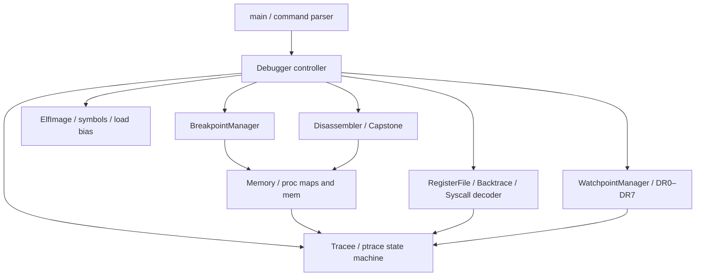

# SDB — Linux x86-64 Debugger in C++

[](https://github.com/Mistbornk/SDB/actions/workflows/ci.yml?query=branch%3Adev)

SDB 是使用 C++17、Linux `ptrace` 與 Capstone 實作的教學型 debugger。
它自行控制 tracee、修改 INT3、處理停止事件與 ELF 位址，不透過 GDB/LLDB 執行核心功能。
支援範圍是 **Linux x86-64 的單一程序、多執行緒 all-stop debugging**。
使用者看到停止事件時，所有受管 tasks 都已停止；可選擇 TID 檢查或單步。

原始版本是 UNIX programming 課程的單檔實作。這次依
[SDB_improve.md](SDB_improve.md) 保留原本的 tracing、breakpoint、patch、syscall 與
反組譯機制，加入可重現測試、明確生命週期、責任分離、ELF symbol breakpoint、
attach/detach、硬體 watchpoint、frame-pointer backtrace 與 syscall 解碼。

## 開發環境

支援 Linux x86-64；`syscall` 命令需要 Linux 5.3+ 的 `PTRACE_GET_SYSCALL_INFO`。
一般 Ubuntu / Debian x86-64 主機可直接安裝依賴：

```sh
sudo apt-get update
sudo apt-get install -y build-essential libcapstone-dev cmake ninja-build python3 binutils
```

也提供從公開 Ubuntu 24.04 base image 建立的 [Dockerfile](Dockerfile)。在 **Linux x86-64
Docker host** 的 fresh checkout 執行以下命令，image 會包含目前專案來源：

```sh
docker build -t sdb-build:ubuntu24.04 .
docker run --rm --init --cap-add SYS_PTRACE sdb-build:ubuntu24.04 \
  bash -lc 'SDB_BUILD_ROOT=/tmp/sdb-ci SDB_REQUIRE_PTRACE=1 ./scripts/ci.sh'
```

進入開發 shell 時可另外掛載 checkout，將 build 產物放在容器 `/tmp`：

```sh
docker run --rm --init --cap-add SYS_PTRACE -it \
  --mount "type=bind,source=$(pwd),target=/workspace/sdb" sdb-build:ubuntu24.04
```

容器使用 `SYS_PTRACE`；`--init` 負責回收退出程序。若主機政策禁止 ptrace，整合測試會
明確標記 skip，`SDB_REQUIRE_PTRACE=1` 則讓驗收失敗。原生 x86 驗收另加
`-e SDB_REQUIRE_NATIVE_WATCHSTEP=1`，要求受 TCG 限制的組合案例也實際執行。

Apple Silicon Mac 需要 **完整 x86-64 Linux VM**；只有 `--platform linux/amd64` 的
userspace 模擬不足以驗證 x86-64 ptrace。Colima 使用者可先 `colima start --arch x86_64`，
再將上述每個 `docker` 命令改為 `docker --context colima`。TCG 的已知限制見下文。

作者原有的 **Colima + `up25_image`** 流程仍可使用：

```sh
./start-dev.sh
```

此腳本會啟動既有 Colima、建立或啟動 `sdb-dev`，將專案掛到 `/workspace/sdb` 並進入 Bash。
它保留原本的個人環境，要求 Colima 已有 `up25_image`；新使用者可用上述公開 Dockerfile。

## Build 與測試

在容器內或 Linux x86-64 主機上：

```sh
make -j4
make test
```

也可用 CMake。Colima 共享目錄使用 SSHFS；將 build 放在容器 `/tmp` 可避開共享檔案系統的
執行權限與 I/O 差異，原始碼仍同步於 Mac：

```sh
cmake -S . -B /tmp/sdb-build -G Ninja -DCMAKE_BUILD_TYPE=Debug
cmake --build /tmp/sdb-build -j4
ctest --test-dir /tmp/sdb-build --output-on-failure
```

Sanitizer 使用獨立 build：

```sh
cmake -S . -B /tmp/sdb-asan -G Ninja -DCMAKE_BUILD_TYPE=Debug -DSDB_SANITIZERS=ON
cmake --build /tmp/sdb-asan -j4
ASAN_OPTIONS=detect_leaks=1:halt_on_error=1 UBSAN_OPTIONS=halt_on_error=1 \
  ctest --test-dir /tmp/sdb-asan --output-on-failure
```

測試範圍、結果與原版 baseline 見 [docs/testing.md](docs/testing.md)。
2026-10-14 驗收：本機 Debug、Release、ASan/UBSan＋leak detection 各通過 **11 組 CTest**。
每組執行 68 個整合測試方法，另 1 個 native 單步/watchpoint 組合案例因 TCG 限制明確 skip。
[原生 GitHub Actions](https://github.com/Mistbornk/SDB/actions/runs/38536434814) 的 Debug、Release、
sanitizer 與公開 Ubuntu Docker image 四個工作全部通過；各執行 **69 個整合測試方法，零 skip**，
另重播錯誤／修正兩個 interview demo session。`scripts/ci.sh` 產生可查核的 JUnit 與 pass/skip 摘要，
[驗收紀錄](docs/testing.md) 保留來源雜湊、原始報告及修復前的失敗案例。

一次執行與 CI 相同的 Debug、Release、ASan/UBSan 三組檢查（JUnit 報告需要 CMake/CTest 3.21+）：

```sh
SDB_BUILD_ROOT=/tmp/sdb-ci SDB_REQUIRE_PTRACE=1 ./scripts/ci.sh
```

`SDB_REQUIRE_PTRACE=1` 會拒絕整組 ptrace 測試因權限而 skip；QEMU TCG 的單一受限案例會另外列出。
原生 x86 驗收再設定 `SDB_REQUIRE_NATIVE_WATCHSTEP=1`，要求單步與 watchpoint 組合案例也實際執行。
原始 pass/fail/skip 結果保留於報告，需求對照見 [docs/improvement-status.md](docs/improvement-status.md)。

## 一分鐘 Demo

以下以 Make 產生的 `./sdb` 為例；CMake 使用者改用 `/tmp/sdb-build/sdb`。

```sh
gcc -O0 -g -fno-omit-frame-pointer -fPIE -pie tests/fixtures/target.c -o /tmp/sdb-target
./sdb -- /tmp/sdb-target
```

```text
break main
cont
info reg
si
cont
q
```

載入會停在 ELF entry；`cont` 命中 `main` 時輸出 `hit a breakpoint` 並將 RIP 修回原指令。
第二次 `cont` 執行 fixture，輸出 `VISITS=10`，最後顯示 `exited with status 0`。
PIE 位址由當次 ASLR 配置決定。

可重播相同流程：

```sh
./sdb --batch tests/scripts/demo.sdb -- /tmp/sdb-target
```

## 面試 Demo：找出寫錯位置的 pointer

[三至五分鐘演示](docs/interview-demo.md) 以訂單金額被運費覆寫的 fixture 展示：硬體
watchpoint 找到寫入、`bt` 定位呼叫鏈、`x` 檢查實際記憶體，再執行修正目的位址的版本。
同一組 checked-in batch scripts 由驗收程式重播並檢查結果：

```sh
python3 tests/interview_demo.py ./sdb --show-output
```

此流程只用 `cont` 恢復程序，適用於原生 x86-64 與具 watchpoint 支援的 x86-64 Colima TCG。
判定成功需同時符合 watchpoint ID、四層呼叫鏈、修改前後 bytes、target 輸出及退出碼。

## 指令

| 指令 | 行為 |
|---|---|
| `load <path> [args...]` | 驗證 ELF、啟動並停在 entry；程序結束後可再次 load |
| `break <hex-address>` | 在 executable mapping 內插入 INT3 |
| `break <symbol>` | 解析主執行檔 `.symtab` / `.dynsym`；支援 PIE |
| `break @name` | 強制符號查詢，避免純十六進位符號名稱被當成位址 |
| `breakrva <hex-offset>` | 相對於最低 PT_LOAD 映射頁面的 offset，保留原版語意 |
| `delete <decimal-id>` | 還原 byte 並移除斷點 |
| `si` | 僅單步選取的 TID，其他 task 保持停止；共用斷點恢復與重新插入流程 |
| `cont` | 執行到下一停止事件或結束 |
| `syscall` | 下一 syscall entry/exit 或其他停止事件 |
| `si/cont/syscall [signal]` | 預設轉送 pending signal；`0` 抑制，亦接受 `SIGUSR1` 等名稱或十進位編號 |
| `info reg` | x86-64 general-purpose registers、RIP、EFLAGS |
| `info break` | 當前斷點 ID 與 runtime address |
| `info maps` | 映射範圍與 read/write/execute 權限 |
| `info environment` | 顯示目前是否禁止 QEMU TCG 的 watchpoint／單步組合 |
| `disasm [hex-address]` | 最多五條指令：位址、原始 bytes、mnemonic、operands |
| `patch <hex-address> <hexbytes>` | 修改 executable memory，最多 1024 bytes，保留斷點 overlay |
| `attach <pid>` / `detach` | SEIZE 既有程序全部 tasks／還原 debugger 修改後釋放 |
| `info threads` / `thread <tid>` | 列出 stopped TIDs／選擇操作對象 |
| `watch <address\|@symbol> [size]` | DR0–DR3 硬體 write watchpoint，長度 1/2/4/8 bytes |
| `awatch <address\|@symbol> [size]` | 硬體 read/write access watchpoint |
| `info watch` / `delete watch <id>` | 列出／移除硬體 watchpoint |
| `x[/count] <address\|@symbol>` | 顯示 logical memory bytes，預設 16，範圍 1–4096 |
| `write <address\|@symbol> <hexbytes>` | 修改 writable data，最多 1024 bytes；例如 `01000000` 寫入四個 bytes |
| `register read [name]` | 讀取全部或指定整數暫存器，包含 `rip`、`fs_base`、`orig_rax` |
| `register write <name> <value>` | 寫入選定 task 暫存器，value 為十進位或 `0x` 開頭的十六進位 |
| `bt [max-frames]` | 最多 64 層的 frame-pointer backtrace，預設 32 |
| `restart` | 重啟上次自行 launch 的程式與參數，清除舊斷點／watchpoints |
| `set disassemble on\|off` | 開關停止時自動反組譯；明確 `disasm` 不受影響 |
| `history` | 顯示最多 256 筆 session 命令 |
| `help` / `q` | 說明／清理後離開；launch 的程序終止，attach 的程序 detach |

位址、RVA 與 patch bytes 使用十六進位（位址可加 `0x`）；斷點 ID 與 signal number 是十進位。
命令支援引號、反斜線 escape、空白行及 `#` 註解；沒有 shell expansion。
`--batch FILE` 與 `--command-file FILE` 等價，`FILE=-` 從 stdin 讀命令。
指令錯誤會顯示 diagnostic 並繼續下一行；只要 session 中曾出錯，SDB 最後回傳 1。
tracee 的非零退出碼會被列印，但不等同 debugger 命令失敗。
`q`、EOF、正常 exception 離開會終止並回收自行 launch 的 child，
或還原所有 INT3 與硬體 debug registers 後 detach 外部程序。`PTRACE_O_EXITKILL`
僅套用自行 launch 的 child；已 attach 的程序不會因普通離開被殺掉。batch 檔適合需要 stdin 的 target；以 stdin 餵 SDB 指令時 target 會共享 stdin。

## 架構與核心不變條件



- 只有有效、所有受管 tasks 都 stopped 時才能讀寫 registers / memory。
- INT3 是整個程序共享的；先修正所有同時命中的 RIP，再逐一執行原指令，期間其他 tasks 保持停止。
- breakpoint 的 ID、位址、原 byte、installed 狀態只有一筆權威紀錄。
- 只有確認屬於已安裝 INT3 的 trap 才能做 RIP−1；其他 SIGTRAP 不冒充斷點。
- exit / signal termination 後清空 session，不再存取 tracee memory。
- patch 寫入成功後才更新 original byte；短寫嘗試 rollback，rollback 失敗就終止 session。
- disassembly 只解碼實際讀到且位於該 executable VMA 的 bytes。

完整說明：[架構與狀態機](docs/architecture.md)、[斷點生命週期](docs/breakpoint-lifecycle.md)、
[工程取捨](docs/engineering-decisions.md)、[thread / attach / watchpoint](docs/task-debugging.md)、
[效能量測](docs/performance.md)、[需求對照](docs/improvement-status.md)。

## 限制與後續方向

- 支援同一程序內 pthread/CLONE_THREAD tasks；**不追蹤 fork/vfork 子程序，不支援跨程序共用記憶體**。
  偵測 fork/vfork 或非 thread clone 時，會還原父子程序的 INT3/DR 並 detach 全部 tasks，明確報錯。
  fork/exec 交錯或 exec 後無法判定子程序的映像來源時，會終止 session；不宣稱可繼續除錯 fork family。
- all-stop 與單一 task `si` 會暫停 peers；若被單步的指令等待另一執行緒（例如 blocking syscall），
  可能等待不結束；互動模式可用 Ctrl-C 重新取得 all-stop prompt。尚未支援 non-stop 或完整 job-control。
- 互動 Ctrl-C 停止受管 tasks；SIGTERM/SIGHUP 和 batch SIGINT 會清理後退出。owned target 會終止並回收，
  attached target 會還原 INT3／DR 後 detach。SIGKILL 或 debugger crash 無法執行這項還原，
  不保證 attached target 能安全繼續。
- 硬體 watchpoint 最多四個槽、必須自然對齊；已啟用其他 hardware breakpoint 的 task 會拒絕新增 SDB watchpoint。
  x86 不提供純 read-only watchpoint，因此 `rwatch` 會明確拒絕，`awatch` 偵測 read/write。
- QEMU TCG 環境下，**啟用硬體 data watchpoint 時禁止單步**，也禁止需要單步的軟體斷點恢復，
  以及在 TF 已設定時繼續執行；可先 `delete watch <id>` 再單步。一般 `cont` 的硬體 watchpoint 仍可使用。
  此保護針對先前在 Colima 發生的 VM 核心 lockup；相關上游報告與驗證界線見
  [task-debugging.md](docs/task-debugging.md#qemu-tcg-protection)。`info environment` 可查詢狀態。
  隱藏 TCG CPUID signature 的環境可設定 `SDB_TCG_GUARD=1` 強制開啟；不能用此變數關閉自動保護。
- `bt` 依賴已建立且保留的 RBP frame chain；建議 `-fno-omit-frame-pointer`。
  prologue/epilogue、tail call、省略 frame pointer、signal/alternate stack 可能漏掉 caller；不是 DWARF unwinder。
- ELF lookup 限主執行檔的原始符號名稱；不解析共享函式庫、DWARF、demangled C++ 名稱或 IFUNC。
  stripped binary 可能沒有 `main` 符號，仍可用位址斷點。
- 接受 executable mapping 裡的 code address，不保證那是原始指令邊界。Capstone 可解碼不等於
  已證明 x86 指令起點。
- 原生 `INT3` 不能再設 software breakpoint；也不能把已設斷點的原 byte patch 成 `0xCC`。
- 自我修改程式碼、目標自行 unmap 斷點頁面、compat-mode/x32 syscall 與完整 job-control stop 語意
  不在支援範圍。step-over/reinsert 無法完成時，會結束 session 並報錯。
- syscall 逐 task 配對，保留 number、return value、RIP，解碼常見 names/args；路徑最多 128 bytes、
  payload 最多 64 bytes，無法讀取的 pointer 明確標示。不是完整 strace，不猜測 syscall 指令起點。
- 載入時若動態 loader 在 entry 前遇到其他停止事件，會回報載入失敗並清理程序。

## 開發背景與授權

此專案從作者的 UNIX programming 課程實作演進；原始單檔版本保留於 Git 歷史，
後續改進與實測紀錄見 [docs/testing.md](docs/testing.md)。未將 GDB/LLDB 當成除錯後端。
核心參考包含 Linux ptrace/procfs 文件、ELF ABI 與 Intel debug-register 手冊，連結列於設計文件；
Capstone 是獨立安裝的 BSD 授權相依套件，並未將其原始碼併入此 repository。

本專案採 [MIT License](LICENSE)。
