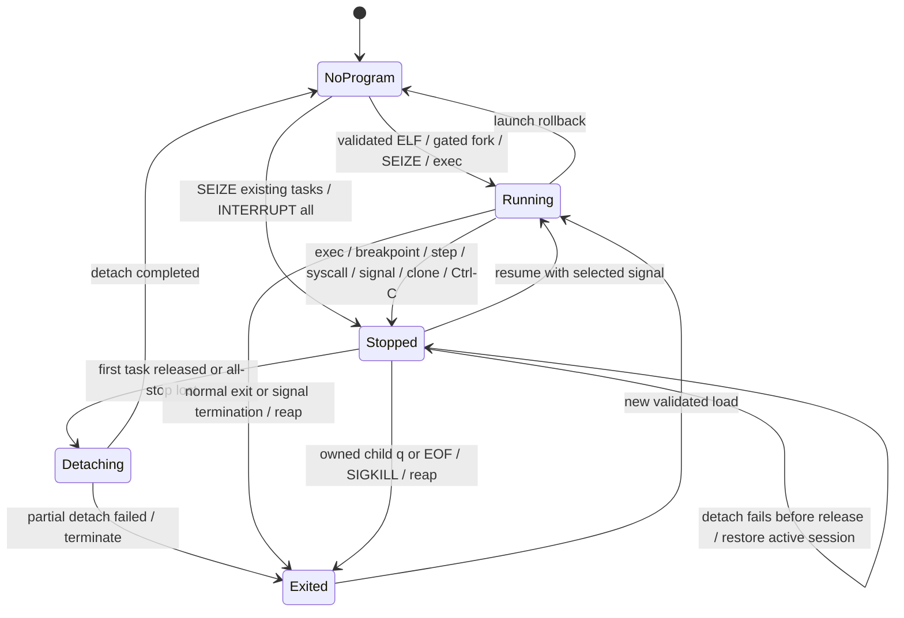

# Architecture and process state

The original `sdb.cpp` implemented `fork`/`TRACEME`/`exec`, an entry INT3,
`PTRACE_SINGLESTEP`, `PTRACE_CONT`, syscall stops, `/proc` memory patching,
register display and Capstone disassembly. The modular version preserves these
mechanisms and the existing command vocabulary. Six automated baseline sessions
ran against the original before replacing its state-management paths.

| Module | Responsibility |
|---|---|
| `main` / `command_parser` | arguments, batch streams, strict numeric/hex/quote parsing, errors |
| `SignalMonitor` | async-signal-safe flags/self-pipe; wakes command input and task waits |
| `Debugger` | command coordination, pending signals, step-over sequencing, event reporting |
| `Tracee` / `TraceEvent` | owns or borrows a TGID and individual TIDs, checked ptrace/waitpid, all-stop, typed events, cleanup |
| `BreakpointManager` | original byte, installed state, ID/address association, memory overlay |
| `Memory` | stopped-state guard, proc maps, bounded reads, transactional writes, FD lifetime |
| `ElfImage` | ELF validation, PT_LOAD, symbol metadata, one address-translation model |
| `Disassembler` | Capstone lifetime and byte-bounded instruction output |
| `WatchpointManager` | per-task DR slots, shared definitions, original-register snapshots and rollback |
| `RegisterFile` | checked register-name mapping, read/write one field while preserving the others |
| `Backtrace` | bounded RBP walk in the current stack mapping, conservative symbol annotation |
| `syscall_decoder` | native x86-64 names/arguments, bounded and escaped pointer previews |

RegisterFile is a stateless name-to-register adapter over Tracee operations.
Syscalls are typed per-task wait events, not a parallel tracing loop.
The controller decides when to resume; CLI parsing never invokes ptrace directly.

`launch()` uses a close-on-exec error pipe. Pipe EOF plus the expected initial
EXEC ptrace event proves exec succeeded; child errors carry the failed operation and errno.
The child waits on a CLOEXEC Unix socket gate while the parent SEIZEs it, then execs.
The parent sends with `MSG_NOSIGNAL`: an early child exit reports EPIPE for cleanup
instead of killing the debugger with SIGPIPE. A closed-peer fault-injection test
checks child reaping and successful reuse of the session. This keeps
launch ownership while enabling PTRACE_INTERRUPT, also on future cloned tasks.
The entry temporary breakpoint uses the same manager as user breakpoints, except
when the initial RIP already equals entry (common for static assembly fixtures).

With a CLI `SignalMonitor`, nonblocking `waitpid` and a self-pipe `poll` form the
wait loop. SIGCHLD queues a wakeup even when it arrives between these operations;
SIGINT/TERM/HUP are checked in normal control flow. The handler only records
`sig_atomic_t` flags and writes a byte to a nonblocking pipe. It never calls
ptrace, allocates memory, formats output or destroys debugger objects.

`waitpid` retries EINTR, then classifies exits before any register read. Stopped
statuses distinguish ptrace exec events, TRACESYSGOOD syscall stops, trap codes,
application signal delivery and group stops. Only syscall stops call
`PTRACE_GET_SYSCALL_INFO`; entry/exit pairing belongs to each task in one Tracee session and is
invalidated when changing resume mode or registers. Unknown pairs are reported as
unknown rather than borrowing the previous session's syscall number.

On Linux x86-64, single-stepping a syscall can generate `TRAP_BRKPT`, while an
ordinary instruction produces `TRAP_TRACE`. Both are recognized in single-step
mode; native INT3's `SI_KERNEL` and user-generated SIGTRAP remain distinct. This
case is covered by both a direct Tracee test and a signal-producing syscall at a
software breakpoint. A nonblocking wait poll reconciles external SIGKILL before
processing the next command, allowing the same debugger to load another program.

Signal delivery stops store a pending signal. The next resume forwards it unless
the user supplies `0` or another signal. A group stop is reported separately:
the current controller does not implement PTRACE_LISTEN/SIGCONT job-control
coordination, so transparent job control is not claimed. An exec event discards old breakpoints without writing to the new address
space and loads metadata for the new executable.

Interactive Ctrl-C during resume requests all-stop and returns to the prompt;
at the prompt it discards the partial input line. The terminal's target-side
SIGINT is not saved as an application signal, so the next `cont` does not kill
the target with the same Ctrl-C. Explicit kill/raise-generated target SIGINT
retains normal signal-delivery behavior. SIGTERM, SIGHUP, and noninteractive
SIGINT request ownership-aware shutdown and exit with `128 + signal`.
This is a controlled-interrupt protocol, not full foreground-process-group or
PTRACE_LISTEN job control.

Path-based ELF validation happens before launch, but metadata after exec comes
from `ElfImage::from_tracee(tid)`. It opens `/proc/TID/exe` itself; bytes and
device/inode identity come from that same descriptor. The symlink's displayed
pathname is only a label. Attach and later exec use the same path, including an
unlinked/replaced executable or a memfd-backed image. Symbols and PT_LOAD
translation therefore describe the executing inode rather than a replacement
file at the former pathname. This does not promise a snapshot against arbitrary
concurrent modification of a still-writable executable backing file.

Natural termination has already reaped the child and invalidated its PID; no
second kill is issued. Explicit termination and EOF kill/reap a live owned child.
Externally attached tasks are borrowed: q/EOF restores every software byte and
hardware-register snapshot, then DETACHes each task with its own pending signal.
Destructors do not throw, and failed cleanup is reported. EXITKILL is set only for
owned children. An unrecoverable partial mutation fails closed by terminating the
tracee, including an attached tracee, rather than releasing corrupted code.

Detach preserves breakpoint/watchpoint definitions until release succeeds. If
preflight or the first DETACH fails while every task is provably held, the
controller reinstalls active INT3/DR state and leaves the same session available
for retry. Once a task was released or all-stop can no longer be established,
the `Detaching` state forbids rollback writes and a failure terminates the
session. SIGKILL and debugger crashes cannot run restoration; an external
process may retain software INT3 bytes after an uncontrolled debugger death.

Clone events add tasks before any public stop returns; PTRACE_INTERRUPT plus
waitpid(__WALL) holds every live task. Simultaneous real stops are queued and
normalized before the controller edits shared code. A nonleader exec replaces all
task/image metadata; leader pthread_exit does not declare the remaining group dead.
See [task debugging](task-debugging.md) for scope and invariants.
