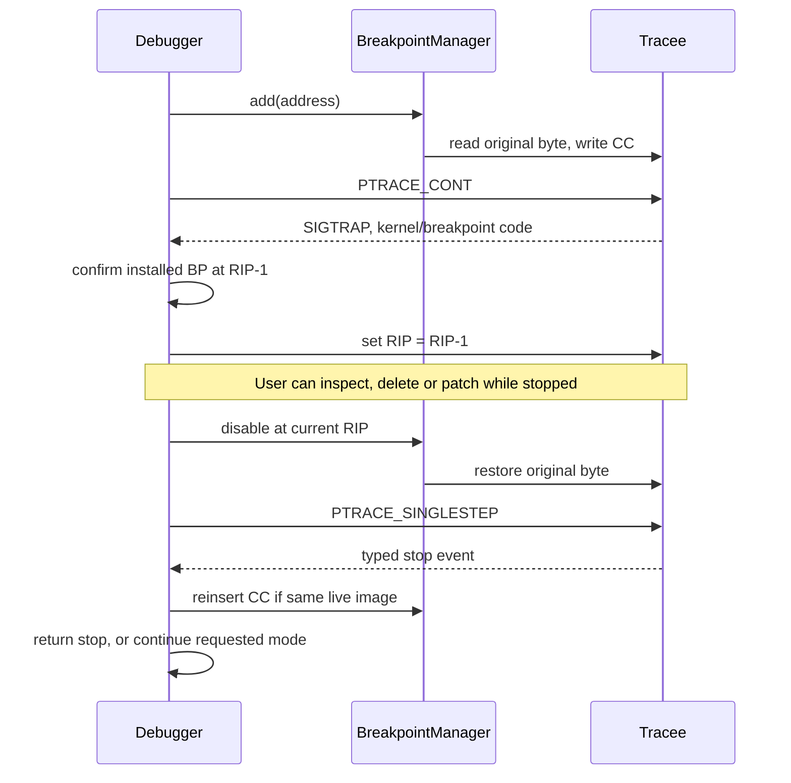

# Software-breakpoint lifecycle

On x86-64, the one-byte `INT3` opcode is `0xCC`. The original program byte is kept
in a single `Breakpoint` record, including its stable session ID and `installed`
flag. A byte value of zero is valid data; errors use exceptions, not byte sentinels.

The shared `Debugger::resume` path serves `si`, `cont` and `syscall`. It keeps the
address by value across resume, never an iterator into a table that exit/exec can
invalidate. If the original instruction is a native x86-64 `syscall` and the user
requested syscall tracing, the internal resume uses PTRACE_SYSCALL so the syscall
entry stop remains visible. For `cont` over a syscall, the same entry boundary
allows INT3 reinsertion before releasing all peers; waiting for a syscall-exit
single-step could deadlock on a futex needing a held peer to wake it. A signal encountered during step-over is reported to
the user; it is not swallowed to reach an expected single-step event.

For `si`, arriving at an address that has a breakpoint is a single-step stop; the
INT3 has not executed yet. The following resume still restores and executes the
original instruction exactly once. An application-generated SIGTRAP is forwarded
as a signal unless its source and address identify one of our installed patches.
RIP−1 alone is never sufficient evidence.

Patch maintains two views: the physical tracee memory may contain CC, while the
debugger's logical code bytes contain the latest original byte. Patch constructs
the physical overlay, writes it transactionally, then commits original-byte
metadata. Removing a breakpoint restores the patched original byte, not an older
snapshot. Disassembly always uses the logical code view.

An exit invalidates the whole table without touching memory. An exec invalidates
the old table before inspecting the new executable. A failed step/reinsertion or
unrecoverable memory rollback ends the session rather than allowing execution
with inconsistent code and metadata.

Addresses are checked against executable mappings, but we do not claim complete
instruction-boundary validation. x86 variable-length decoding can succeed in the
middle of another instruction. Native CC instructions and self-modifying code
require additional semantics and are explicitly outside this implementation's
software-breakpoint contract.

## Multiple tasks and detach

INT3 bytes belong to a shared address space. On any visible stop, Tracee interrupts
all running peers and drains their wait statuses. The controller corrects **all**
queued owned INT3 RIPs before permitting a delete, patch, detach or resume.
For continue/syscall, every task parked at an installed breakpoint is stepped
one at a time while peers stay stopped; only then can the entire group run.
This prevents another thread from crossing the temporarily restored byte.

Detach restores every installed original byte and every hardware debug-register
snapshot while the tasks remain held, then releases them. Pending application
signals remain per task; synthetic debugger SIGTRAPs are never injected. If
restoring multiple breakpoints fails, previously restored bytes are reinserted;
a failed rollback is fatal. Exec/terminal events supersede stale peer stops and
invalidate the old image before any old byte can be reinserted.
